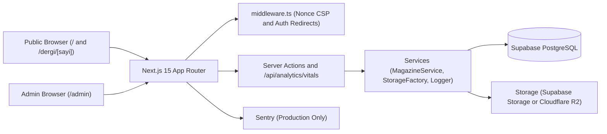

<div align="center">


# Balkon Dergisi

Digital magazine platform for Sezai Karakoç Anadolu Lisesi.

[](./LICENSE)

</div>

---

## Overview

Balkon Dergisi converts PDF issues into WebP page sets in the browser, stores assets in Supabase Storage or Cloudflare R2, and serves them through an interactive flipbook reader with engagement and Web Vitals analytics.

## Core Capabilities

| Capability | Summary |
|---|---|
| **Flipbook Reader** | Renders issues at `/dergi/[sayi]` with `react-pageflip`, 1x–4x zoom, page jump input, left/right arrow navigation, Web Audio flip sound, and sliding-window prefetching |
| **Client PDF Pipeline** | Extracts PDF pages in a `pdfjs-dist` web worker, renders to `HTMLCanvasElement` as WebP, and uploads sequentially via Server Actions |
| **Admin Portal** | Authenticated dashboard at `/admin` with issue CRUD, optimistic locking on renames, reader analytics (`/admin/analytics`), and Web Vitals (`/admin/performance`) |
| **Dual Storage** | Switches between Supabase Storage (default) and Cloudflare R2 (`@aws-sdk/client-s3`) via `StorageFactory` |
| **Security & Telemetry** | Nonce-based CSP in `middleware.ts`, security headers in `next.config.ts`, PII-redacted logging, and production Sentry tracking |

See [Architecture](docs/architecture.md) for component flows, database schema, security controls, and PWA caching details.

## Architecture



## Quickstart

1. Install dependencies (automatically runs `postinstall` to copy the PDF.js worker to `public/`):

   ```bash
   pnpm install
   ```

2. Copy the environment template and set your credentials (see [Environment Variables](docs/setup.md#environment-variables)):

   ```bash
   cp .env.example .env.local
   ```

3. Apply the SQL migrations in Supabase and configure storage buckets (see [Supabase Setup](docs/setup.md#supabase-setup)).

4. Start the development server at `http://localhost:3000`:

   ```bash
   pnpm dev
   ```

5. Run the unit test suite:

   ```bash
   pnpm test
   ```

## Documentation

- [Setup and Deployment](docs/setup.md) — prerequisites, environment variables, Supabase and Cloudflare R2 configuration, scripts, Sentry, and troubleshooting
- [Architecture](docs/architecture.md) — layered architecture, directory map, PDF upload sequence, flipbook reader, database schema, security, and PWA caching
- [Contributing](docs/contributing.md) — coding conventions, error handling, validation, verification commands, and PR workflow

## License

This project is licensed under the MIT License — see [LICENSE](./LICENSE).

Copyright (c) 2026 Efe Arabacı
