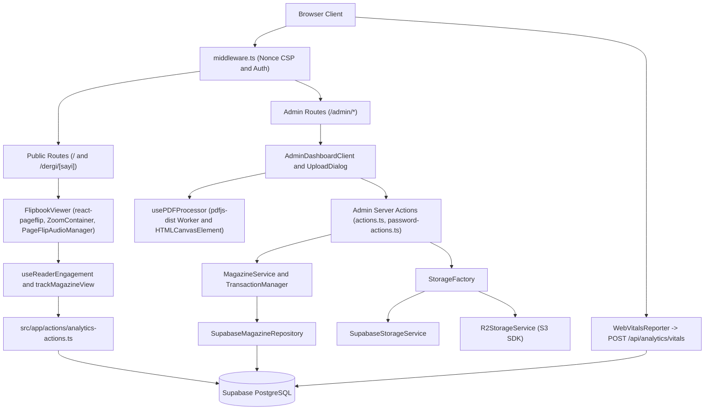
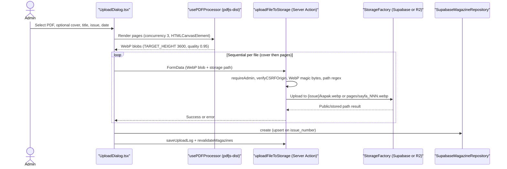
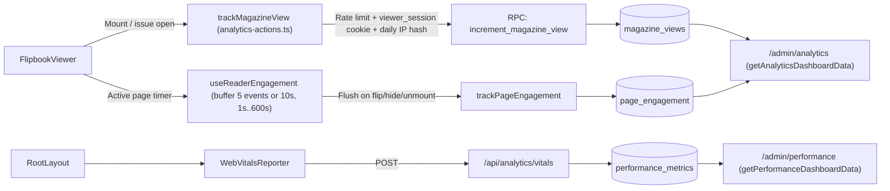

# Architecture

## Layered Overview

Balkon Dergisi is a Next.js 15 App Router application organized into five layers:

1. **Routing & Middleware (`middleware.ts`, `src/app/`)**: Enforces nonce-based Content Security Policy, checks Supabase Auth for `/admin/*` routes, serves ISR public pages (`/` and `/dergi/[sayi]`, `revalidate = 3600`), admin pages (`/admin`, `/admin/login`, `/admin/analytics`, `/admin/performance`), Server Actions, and `/api/analytics/vitals`.
2. **Presentation & Hooks (`src/components/`, `src/hooks/`)**: Renders the landing page, `FlipbookViewer` (`react-pageflip`), zoom/jump controls, `UploadDialog` (lazy-loaded with `next/dynamic({ ssr: false })`), and admin tables/charts.
3. **Domain Services & Processors (`src/lib/services/`, `src/lib/processors/`)**: Handles client PDF/image processing (`usePDFProcessor`, `PDFProcessor`, `ImageProcessor`), issue management (`MagazineService`, `TransactionManager`), authentication/CSRF/rate-limiting (`authorization.ts`, `rateLimiting.ts`), and PII-redacted logging (`Logger`).
4. **Repositories & Storage (`src/lib/repositories/`, `src/lib/services/storage/`)**: Abstracts PostgreSQL reads/writes (`SupabaseMagazineRepository`) and object storage (`StorageFactory` switching between `SupabaseStorageService` and `R2StorageService`).
5. **Validation, Guards & Errors (`src/lib/validators/`, `src/lib/guards/`, `src/lib/errors/`)**: Provides Zod schemas, runtime type guards, and typed `AppError` / `ErrorHandler` `Result` wrappers.



## Directory Map

```text
public/
├── favicon.png
├── offline.html                  # Offline fallback served by sw.js
├── pdf.worker.min.mjs            # Copied from pdfjs-dist on postinstall
├── sounds/
│   └── page-flip.opus            # Web Audio page flip sound
└── sw.js                         # Service Worker (cache-first, SWR, 50MB image cap)

src/
├── app/
│   ├── (admin)/
│   │   ├── layout.tsx            # ReactQueryProvider and Suspense boundary
│   │   └── admin/
│   │       ├── page.tsx          # Admin dashboard (requireAdmin)
│   │       ├── actions.ts        # Upload, CRUD, and revalidation Server Actions
│   │       ├── password-actions.ts
│   │       ├── AdminDashboardClient.tsx
│   │       ├── MagazineTable.tsx
│   │       ├── UploadDialog.tsx  # Dynamic client PDF-to-WebP uploader
│   │       ├── analytics/        # /admin/analytics
│   │       ├── performance/      # /admin/performance
│   │       └── login/            # /admin/login
│   ├── (public)/
│   │   ├── page.tsx              # Home page (ISR 3600s)
│   │   └── dergi/[sayi]/
│   │       └── page.tsx          # Issue reader page (ISR 3600s, JSON-LD)
│   ├── actions/
│   │   ├── analytics-actions.ts  # View tracking, page engagement, analytics queries
│   │   └── performance-actions.ts
│   ├── api/analytics/vitals/
│   │   └── route.ts              # POST endpoint for Core Web Vitals
│   ├── layout.tsx                # RootLayout (WebVitalsReporter, ServiceWorkerRegister, Toaster)
│   ├── error.tsx / not-found.tsx / robots.ts / sitemap.ts / icon.tsx / apple-icon.tsx
├── components/
│   ├── FlipbookViewer.tsx        # Core reader, keyboard arrows, dynamic flip timing
│   ├── FlipbookViewerErrorBoundary.tsx
│   ├── FlipbookViewerSkeleton.tsx
│   ├── OptimizedImage.tsx        # Connection-aware quality + SVG blur placeholder
│   ├── ServiceWorkerRegister.tsx
│   ├── WebVitalsReporter.tsx
│   ├── reader/
│   │   ├── FlipbookPage.tsx      # Page rendering with createPageWindowStore
│   │   ├── PageJumpInput.tsx     # Direct page navigation
│   │   └── ZoomContainer.tsx     # 1x-4x wheel, pinch, drag, and lock
│   └── ui/                       # Radix UI primitives and shared UI components
├── hooks/
│   ├── index.ts                  # Exports upload, storage, Supabase, and wake-lock hooks
│   ├── useFileUpload.ts
│   ├── usePDFProcessor.ts
│   ├── useReaderEngagement.ts    # Imported directly by FlipbookViewer.tsx
│   ├── useStorageService.ts
│   ├── useUploadPersistence.ts   # sessionStorage resume state
│   └── useWakeLock.ts
├── lib/
│   ├── audio/pageFlipAudio.ts    # PageFlipAudioManager
│   ├── config/                   # app-config.ts, env.ts, serverEnv.ts, types.ts
│   ├── constants/                # upload.ts, flipbook.ts, storage.ts, errorCatalog.ts
│   ├── env.ts                    # Public env schema (duplicated with lib/config/env.ts)
│   ├── errors/                   # AppError, DatabaseApiError, ErrorHandler, GlobalErrorHandler
│   ├── guards/                   # magazineGuards.ts, storageGuards.ts, runtimeTypeGuards.ts
│   ├── magazines.ts              # Public cached reads (unstable_cache 60s + React cache)
│   ├── middleware/               # authMiddleware.ts
│   ├── processors/               # FileProcessorFactory, PDFProcessor, ImageProcessor
│   ├── repositories/             # IMagazineRepository, SupabaseMagazineRepository
│   ├── security/jsonLd.ts        # JSON-LD escaping helper
│   ├── services/                 # MagazineService, TransactionManager, UploadService,
│   │                             # Logger, authorization, rateLimiting, fileValidation,
│   │                             # IdempotencyManager, PerformanceMonitor, storage/
│   ├── supabase/                 # client.ts, server.ts, admin.ts
│   ├── utils/                    # pagePrefetcher.ts, retry.ts, pathUtils.ts, storage-paths.ts
│   └── validators/               # Zod schemas and FormData parsers
├── migration/
│   ├── database_setup.sql
│   ├── page_engagement.sql
│   └── performance_metrics.sql
├── providers/ReactQueryProvider.tsx
└── types/
```

## PDF Processing and Upload Pipeline

PDF conversion happens entirely on the admin's browser to avoid server CPU and memory bottlenecks:



Key implementation details:

- **Rendering settings (`src/lib/constants/upload.ts`)**: `usePDFProcessor` and `PDFProcessor` use `TARGET_HEIGHT = 3600`, `WEBP_QUALITY = 0.95`, `FORMAT = 'image/webp'`, and `document.createElement('canvas')` (`HTMLCanvasElement`, 2D context). `usePDFProcessor` runs a concurrency pool of `3` and calls `pdfPage.cleanup()` and `pdfDoc.destroy()` to release memory. (Note: `src/lib/config/app-config.ts` defines unused `UPLOAD_CONFIG` values of `targetHeight: 2400` and `webpQuality: 0.9`.)
- **Upload execution (`UploadDialog.tsx`, `useFileUpload.ts`, `src/app/(admin)/admin/actions.ts`)**: Files are uploaded sequentially through `uploadFileToStorage` (Server Actions configured with `bodySizeLimit: '500mb'`). `uploadFileToStorage` checks `requireAdmin()`, `verifyCSRFOrigin()`, `<= 500MB`, `image/webp` MIME + `RIFF`/`WEBP` magic bytes, and the canonical path regex `^\d+\/(?:kapak\.webp|pages\/sayfa_\d{3}\.webp)$`.
- **Resume and persistence**: `useUploadPersistence` stores partial upload state in `sessionStorage`, `IdempotencyManager` tracks uploaded issue keys in `localStorage`, and `useWakeLock` requests screen wake lock while processing.
- **Note on unused service-layer upload orchestration**: `UploadService.ts` and `MagazineService.uploadMagazineWithFiles` implement `TransactionManager` rollback and `CONCURRENT_UPLOADS = 5`, but `UploadDialog.tsx` calls `uploadFileToStorage` and `SupabaseMagazineRepository.create` directly; `saveUploadLog` logs length metadata via `Logger` without writing files to the `magazine-upload-logs` bucket.

## Interactive Flipbook Reader

The public reader lives at `src/app/(public)/dergi/[sayi]/page.tsx` (`revalidate = 3600`):

- **SSR & Discovery**: Validates the `[sayi]` parameter with `validatePageNumber`, loads magazine metadata via `getMagazineByIssue` (`src/lib/magazines.ts`, wrapped with `unstable_cache` 60s and React `cache`), lists page assets through `StorageFactory.getStorageService(supabase).list(...)`, and renders `FlipbookViewerErrorBoundary` -> `DynamicFlipbookViewer`.
- **Page Turning (`FlipbookViewer.tsx`)**: Wraps `react-pageflip` (`size="stretch"`, aspect base `848x1200` from `src/lib/constants/flipbook.ts`) with dynamic flip durations (`NORMAL_FLIP_DURATION = 450` ms; `RAPID_FLIP_DURATION = 250` ms when flips occur within `RAPID_FLIP_THRESHOLD_MS = 600` ms).
- **Zoom, Jump & Keyboard**:
  - `ZoomContainer` (`src/components/reader/ZoomContainer.tsx`) supports `1x`–`4x` zoom via wheel, pinch, and drag, and locks page flipping while zoomed.
  - `PageJumpInput` (`src/components/reader/PageJumpInput.tsx`) accepts direct page number jumps (`Escape` blurs the input).
  - `FlipbookViewer.tsx` binds `ArrowLeft` and `ArrowRight` for page navigation.
- **Audio (`src/lib/audio/pageFlipAudio.ts`)**: `PageFlipAudioManager` decodes and plays `/sounds/page-flip.opus` via the Web Audio API (randomized playback rate `0.94`–`1.06`, gain `0.65`, mute persisted in `localStorage` under `balkon_reader_muted`).
- **Prefetching (`src/lib/utils/pagePrefetcher.ts`)**: `prefetchSlidingWindow` and `idlePrefetchAllPages` preload and decode upcoming pages using `PAGES_AHEAD = 6`, `PAGES_BEHIND = 2`, and `DECODE_CONCURRENCY = 2` from `src/lib/constants/flipbook.ts`, synchronized with `FlipbookPage` via `createPageWindowStore` and `useSyncExternalStore`. (Note: `src/lib/config/app-config.ts` retains separate unused constants `pagesAhead: 3`, `pagesBehind: 1`.)

## Storage Layout and Providers

`StorageFactory.getStorageService(supabase?)` (`src/lib/services/storage/StorageFactory.ts`) returns an `IStorageService`:

- **`supabase` (default)**: `SupabaseStorageService` operating on the `magazines` bucket.
- **`r2`**: `R2StorageService` using `@aws-sdk/client-s3` (`https://${R2_ACCOUNT_ID}.r2.cloudflarestorage.com`, `region: 'auto'`, `forcePathStyle: true`).

`StorageService` wraps `IStorageService` with retry (`withRetry`), batched operations, chunked deletions (1,000 keys per batch), recursive listing, file moves, and `PerformanceMonitor` timing.

Canonical storage key layout for issue `N`:

```text
{N}/
├── kapak.webp
└── pages/
    ├── sayfa_001.webp
    ├── sayfa_002.webp
    └── ...
```

## Database Schema

Defined across three files in `src/migration/`:

- **`public.magazines`** (`database_setup.sql`): `id`, `created_at`, `title`, `issue_number` (unique), `publication_date`, `cover_image_url`, `pdf_url`, `page_count`, `is_published` (default `TRUE`), `version` (default `1`, used for optimistic locking in `MagazineService.renameMagazine`).
- **`public.user_profiles`** (`database_setup.sql`): `user_id` (PK referencing `auth.users`), `role` (`'admin'` or `'user'`), `created_at`.
- **`public.magazine_pages`** (`database_setup.sql`): optional page metadata table (`id`, `created_at`, `magazine_id`, `page_number`, `image_url`), currently unused by `src/`.
- **`public.magazine_views`** (`database_setup.sql`): `id`, `magazine_id`, `viewed_at`, `session_id`, `viewer_ip_hash`, `user_agent_family`.
- **`public.page_engagement`** (`page_engagement.sql`): `id`, `session_id`, `magazine_id`, `page_number`, `duration_seconds`, `created_at`.
- **`public.performance_metrics`** (`performance_metrics.sql`): `id`, `metric_id`, `name`, `value`, `path`, `user_agent`, `created_at`.

Database RPCs: `current_user_is_admin()`, `increment_magazine_view()` (deduplicates by `session_id` over 24h and `viewer_ip_hash` over 1h), `get_advanced_analytics()`, and `get_page_analytics()`.

## Analytics and Web Vitals



- `trackMagazineView` (`src/app/actions/analytics-actions.ts`) enforces an in-memory rate limit (`60` requests per `5` minutes per `magazineId:ip`), sets an `httpOnly` `viewer_session` UUID cookie (30 days), and hashes the client IP with a daily rotating salt.
- `useReaderEngagement` (`src/hooks/useReaderEngagement.ts`) pauses when `document.visibilityState === 'hidden'`, ignores dwell times under `1` second, caps per-page dwell times at `600` seconds, and buffers up to `5` events or `10` seconds before flushing.
- `RootLayout` (`src/app/layout.tsx`) also mounts `@vercel/analytics/next` (`Analytics`).

## Security and Authentication

- **Middleware (`middleware.ts`)**: Generates a 16-byte per-request nonce (`x-nonce`), sets `Content-Security-Policy` (`default-src 'self'`, `script-src 'self' 'nonce-${nonce}' https://cdn.jsdelivr.net`, `style-src 'self' 'nonce-${nonce}' https://fonts.googleapis.com`, `img-src 'self' data: blob: https:`, `font-src 'self' data: https://fonts.gstatic.com`, `connect-src 'self' https://${supabaseDomain} https://*.supabase.co` plus optional `NEXT_PUBLIC_R2_PUBLIC_URL`, `object-src 'none'`, `frame-src 'none'`, `frame-ancestors 'none'`, `base-uri 'self'`, `form-action 'self'`), calls `supabase.auth.getUser()`, redirects unauthenticated `/admin/*` requests to `/admin/login`, and redirects authenticated `/admin/login` requests to `/admin`.
- **Static Security Headers (`next.config.ts`)**: Applies `X-Content-Type-Options: nosniff`, `X-Frame-Options: DENY`, `X-XSS-Protection: 1; mode=block`, `Referrer-Policy: strict-origin-when-cross-origin`, and `Permissions-Policy: camera=(), microphone=(), geolocation=()` on `/(.*)`.
- **Authorization & CSRF**: Admin Server Actions enforce `requireAdmin()` (verifying `auth.getUser()` and `user_profiles.role === 'admin'`) and `verifyCSRFOrigin()`.
- **Rate Limiting (`src/lib/services/rateLimiting.ts`)**: In-memory sliding limits for login (`5` / 15m per IP), `addMagazineRecord` upload (`10` / 1h per `userId`), password change (`5` / 15m per `userId`), and view tracking (`60` / 5m per `magazineId:ip`).
- **JSON-LD Sanitization**: `escapeJsonLd` (`src/lib/security/jsonLd.ts`) escapes structured data injected into `<script type="application/ld+json">` tags alongside the request `nonce`.

## PWA, Caching, and Bundle Splitting

- **Service Worker (`public/sw.js` via `ServiceWorkerRegister`)**:
  - `CACHE_NAME = 'balkon-cache-v1'` precaches `['/', '/offline.html', '/favicon.png', '/pdf.worker.min.mjs']`.
  - `IMAGE_CACHE_NAME = 'balkon-images-cache'` enforces a 50 MB size limit (`50 * 1024 * 1024`), evicting oldest entries ordered by response `date` header.
  - Uses **Network-First** (with `/offline.html` fallback) for navigation requests, **Stale-While-Revalidate** for images, **Cache-First** for static scripts, styles, fonts, `.mjs`, and `/_next/static/`, and **Network-First** for other `GET` requests.
- **Connection-Aware Images (`src/components/OptimizedImage.tsx`)**: Inspects the Network Information API (`navigator.connection`) to select quality `60` on slow (`slow-2g`/`2g`/`3g`) or `saveData` connections and `90` otherwise, and renders inline SVG blur placeholders.
- **Bundle Splitting (`next.config.ts`)**: Production client Webpack builds split `pdfjs-dist` (`pdfjs`), `react-pageflip` (`pageflip`), `recharts` (`recharts`), React/Next core (`framework`), and vendor modules over 80 KB (`lib-*`) into separate chunks. `UploadDialog`, `FlipbookViewer`, and `AnalyticsDashboard` are also lazy-loaded with `next/dynamic`.
